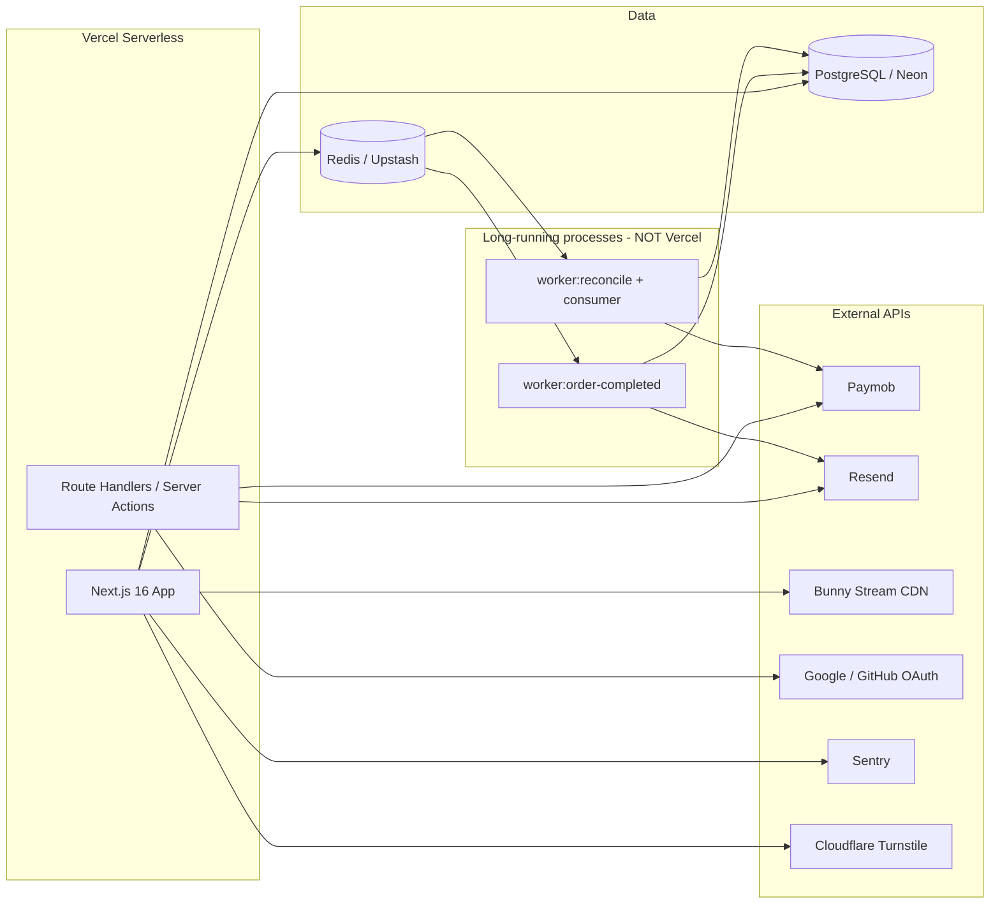

# IthraCode — Production External Dependencies

Production readiness for **Vercel (web)** plus **required external services** inferred from code.

---

## Architecture overview

---

## 1. PostgreSQL (Neon recommended)

| Item | Detail |
|------|--------|
| **Active** | Yes — Prisma 7 + `@prisma/adapter-pg` (`src/lib/prisma.ts`) |
| **Required for first deploy** | **Yes** |
| **Credentials** | `DATABASE_URL` (runtime, pooler), `DIRECT_URL` (migrations CLI) |
| **Obtain** | [Neon](https://neon.tech) + Vercel integration, or any PostgreSQL 14+ |
| **Vercel config** | Use pooled URL; `sslmode=require` normalized to `verify-full` in code |
| **Migrations** | `prisma.config.ts` uses `DATABASE_URL`; `prisma/prisma.config.ts` uses `DIRECT_URL` for migrate |
| **CI** | `.github/workflows/ci.yml` runs type-check/lint only — **no migrate on deploy** |

**Readiness:** Provision DB, run migrations before first production traffic, seed only for non-prod.

---

## 2. Redis (Upstash recommended)

| Item | Detail |
|------|--------|
| **Active** | Yes — `ioredis` (`src/lib/redis.ts`), checkout locks, rate limits, BullMQ |
| **Required for first deploy** | **Yes** (imported at runtime with validated `REDIS_URL`) |
| **Credentials** | `REDIS_URL` — prefer `rediss://` (TLS) |
| **Obtain** | [Upstash](https://upstash.com) + Vercel Redis integration |
| **Failure mode** | Connection errors logged; checkout locks / queues fail without Redis |

---

## 3. Auth.js (NextAuth v5)

| Item | Detail |
|------|--------|
| **Active** | Yes — `src/lib/auth.ts`, `src/proxy.ts` (edge proxy), Prisma adapter |
| **Required for first deploy** | **Yes** — `AUTH_SECRET`, `AUTH_URL` |
| **OAuth** | Google + GitHub optional via `AUTH_*_ID` / `AUTH_*_SECRET` |
| **Callbacks** | `https://YOUR_DOMAIN/api/auth/callback/{google\|github}` |
| **Dashboard** | Google Cloud Console, GitHub OAuth Apps |
| **Production note** | `ensureProductionAuthUrl` recovers from stale localhost `AUTH_URL` when possible (`auth.ts:35–73`) |

---

## 4. Paymob (primary payment provider)

| Item | Detail |
|------|--------|
| **Active** | Yes — `PaymobGateway`, Pixel checkout, webhook at `src/app/api/payment/webhooks/paymob/route.ts` |
| **Required for first deploy** | **Yes** if selling courses in production |
| **Credentials** | `PAYMOB_SECRET_KEY`, `PAYMOB_PUBLIC_KEY`, `PAYMOB_HMAC_SECRET`, `PAYMOB_INTEGRATION_IDS`, optional `PAYMOB_API_KEY` |
| **Obtain** | Paymob Accept dashboard (API keys, HMAC, integration IDs) |
| **Webhook URL** | `https://YOUR_DOMAIN/api/payment/webhooks/paymob` |
| **Dashboard** | Configure processed transaction webhook + HMAC |
| **Not active** | Stripe routes absent; PayPal enum + fake gateway only |

**Production behavior:** `payments.container.ts` registers **FakePaymentGateway** only when `NODE_ENV !== 'production'`. Production **requires** Paymob config for checkout and webhooks.

---

## 5. PayPal & Stripe

| Item | Detail |
|------|--------|
| **Active** | **No** — Prisma enum / metadata types only; checkout API accepts `PAYPAL` in Zod but no live gateway |
| **Required for first deploy** | **No** |
| **Env vars** | None in code |
| **Action** | Remove orphaned `STRIPE_*` from local `.env` only; do not configure on Vercel |

---

## 6. Resend (email)

| Item | Detail |
|------|--------|
| **Active** | Yes — purchase confirmation + contact notifications |
| **Required for first deploy** | **No** (site runs; emails skipped) |
| **Credentials** | `RESEND_API_KEY`, `PAYMENT_EMAIL_FROM`, `CONTACT_NOTIFICATION_EMAIL` |
| **Obtain** | [Resend](https://resend.com) — verify sending domain |
| **Dependency** | Order confirmation emails queued by webhook → **order-completed worker** must run |

---

## 7. Bunny Stream (video playback)

| Item | Detail |
|------|--------|
| **Active** | Yes — signed HLS URLs (`src/lib/bunny-stream.ts`, Shaka player) |
| **Required for first deploy** | **No** — playback URL `null` if unset |
| **Credentials** | `BUNNY_STREAM_CDN_HOSTNAME`, `BUNNY_STREAM_TOKEN_AUTH_KEY` |
| **Obtain** | Bunny.net Stream → security → token authentication |
| **Note** | Video records store `bunnyVideoId` in DB; upload pipeline not covered in this env audit |

---

## 8. Cloudflare Turnstile

| Item | Detail |
|------|--------|
| **Active** | Yes — contact form (`src/features/contact/*`) |
| **Required for first deploy** | **Recommended** — without keys, widget off; verification required if site key set |
| **Credentials** | `NEXT_PUBLIC_TURNSTILE_SITE_KEY`, `TURNSTILE_SECRET_KEY` |
| **Obtain** | Cloudflare Turnstile dashboard — restrict to your domain |
| **Webhook/callback** | None — siteverify API |

---

## 9. Sentry

| Item | Detail |
|------|--------|
| **Active** | Yes — `@sentry/nextjs`, tunnel `src/app/monitoring/route.ts` |
| **Required for first deploy** | **No** — missing DSN disables reporting with console error |
| **Credentials** | `NEXT_PUBLIC_SENTRY_DSN`, `SENTRY_ENVIRONMENT`, optional `SENTRY_AUTH_TOKEN` |
| **Obtain** | sentry.io project |
| **Build** | Source maps need `SENTRY_AUTH_TOKEN` on build environment |
| **Safety** | `SENTRY_TEST_ENDPOINT_ENABLED` must be `false` in production |

---

## 10. BullMQ background workers

| Item | Detail |
|------|--------|
| **Active** | Yes — `order-completed`, `reconcile-payments` queues |
| **Required for first deploy** | **Yes for full payment UX** (emails, invoices, analytics jobs) |
| **Host** | **Not Vercel** — separate process: `pnpm worker:order-completed`, `pnpm worker:reconcile`, `pnpm worker:reconcile-consumer` |
| **Shared env** | Same `REDIS_URL`, `DATABASE_URL`, Paymob, Resend as web app |
| **Reconciliation** | Optional Vercel Cron could call `/api/admin/payment/reconcile` with `PAYMENT_RECONCILE_ADMIN_SECRET` — **not configured in repo** |

---

## 11. Google Calendar

| Item | Detail |
|------|--------|
| **Active** | **No application code** — `GoogleCalendarToken` Prisma model exists |
| **Required for first deploy** | **No** |
| **Env vars** | None |

---

## 12. AI / LangChain / OpenAI / Langfuse

| Item | Detail |
|------|--------|
| **Active** | **No** — packages in `package.json`, zero env usage in `src/` |
| **Required for first deploy** | **No** |
| **Local `.env` only** | `AI_*`, `OPENAI_*` names may exist locally — not production |

---

## 13. Vercel platform

| Item | Detail |
|------|--------|
| **Config** | `vercel.json` — `NODE_OPTIONS=--disable-warning=DEP0169` |
| **Next config** | Disables `standalone` when `VERCEL` is set (`next.config.ts`) |
| **Auto env** | `VERCEL`, `VERCEL_URL`, `VERCEL_PROJECT_PRODUCTION_URL` |
| **Cron** | None defined |
| **Edge** | `api/health/live` uses edge runtime without `@/config` |

---

## Production readiness matrix

| Service | Configure before launch | Blocker if missing |
|---------|-------------------------|-------------------|
| Neon PostgreSQL | ✓ | App / auth / courses break |
| Upstash Redis | ✓ | Locks, cart, payments degraded |
| AUTH_SECRET + URLs | ✓ | Auth broken |
| Paymob (live) | ✓ for sales | Checkout unavailable in prod |
| Bunny Stream | ✓ for video | Lectures without HLS |
| Resend | Recommended | No transactional email |
| Turnstile | Recommended | Contact spam risk |
| Sentry | Recommended | No error visibility |
| BullMQ workers | ✓ for emails | Orders fulfill but no email/invoice jobs |
| OAuth providers | Optional | Social login disabled if omitted |

---

## Webhook & callback URL summary

| Provider | URL |
|----------|-----|
| Paymob webhook | `https://YOUR_DOMAIN/api/payment/webhooks/paymob` |
| Google OAuth | `https://YOUR_DOMAIN/api/auth/callback/google` |
| GitHub OAuth | `https://YOUR_DOMAIN/api/auth/callback/github` |
| Sentry tunnel | `https://YOUR_DOMAIN/monitoring` (same-origin; no provider config) |

---

## Prioritized launch sequence

1. Create Neon DB + run Prisma migrations (`DATABASE_URL` / `DIRECT_URL`).
2. Create Upstash Redis; set `REDIS_URL`.
3. Generate `AUTH_SECRET`; set `AUTH_URL` + `NEXT_PUBLIC_APP_URL` to production domain.
4. Configure Google/GitHub OAuth redirect URIs.
5. Configure Paymob keys + webhook HMAC + integration IDs (test in Preview with test keys).
6. Configure Bunny token auth for course video.
7. Configure Resend domain + from addresses.
8. Set Sentry DSN + `SENTRY_ENVIRONMENT=production` on **Production** and build env.
9. Deploy to Vercel; verify `/api/health/live`.
10. Start BullMQ workers on a persistent host with identical env.
11. Smoke-test: sign-in, checkout, Paymob webhook, lecture playback, contact form.
12. Schedule reconcile (worker or secured admin API).

---

## Deployment blockers (confirmed from code)

1. **Missing T3-required vars** → import of `@/config` throws during build or first request (`proxy.ts`, `prisma.ts`, `redis.ts`).
2. **Paymob not configured in production** → checkout page shows error (`checkout/page.tsx`); webhooks return 503.
3. **Workers not running** → `OrderCompleted` jobs pile up in Redis; no confirmation emails/PDF jobs.
4. **Preview OAuth** → redirect URIs must include each preview host or use a stable staging domain.
5. **`SKIP_ENV_VALIDATION=true` on Vercel** → hides misconfiguration — do not use.