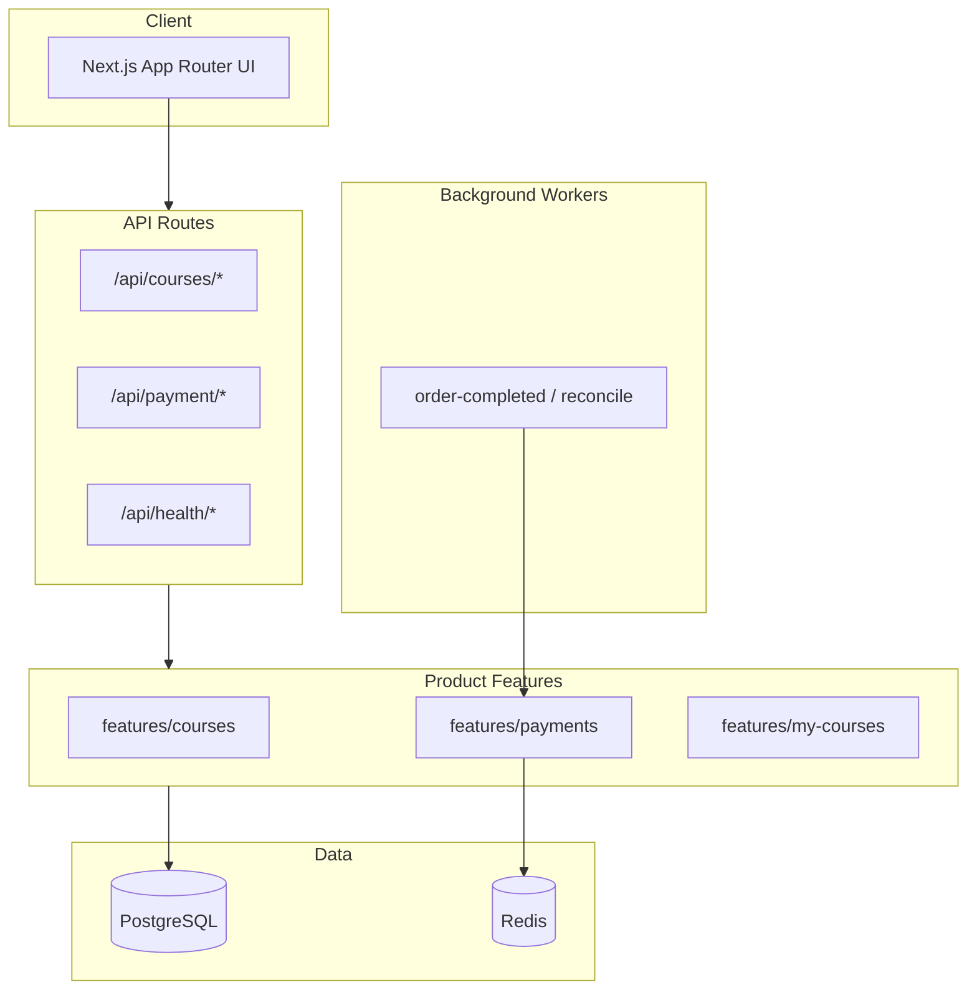

<h1 align="center">IthraCode</h1>

<p align="center">
  <strong>Arabic-first online learning platform for programming and web development courses</strong>
</p>

<p align="center">
  <a href="#overview">Overview</a> ·
  <a href="#key-features">Features</a> ·
  <a href="#architecture">Architecture</a> ·
  <a href="#environment-setup">Setup</a> ·
  <a href="#available-commands">Commands</a> ·
  <a href="#documentation">Docs</a>
</p>

---

## Overview

**IthraCode** is a full-stack, Arabic-first (RTL) learning platform for programming and web
development courses. It provides course discovery, enrollment, video-based learning, multi-provider
payments, and instructor tooling.

---

## Key Features

### Learning Platform

| Area            | Capabilities                                                                                           |
| --------------- | ------------------------------------------------------------------------------------------------------ |
| **Students**    | Course catalog, learning paths, cart, checkout, enrolled-course study view, progress tracking, reviews |
| **Instructors** | Course/section/lecture management, Bunny Stream video, attachments, consultation availability          |
| **Admins**      | User/course management, payment reconciliation                                                         |
| **Auth**        | NextAuth v5 — credentials, Google, GitHub; role-based access (Student / Instructor / Admin)            |
| **Payments**    | Stripe (default) + optional Paymob; webhooks, BullMQ fulfillment, reconciliation workers               |
| **Progress**    | Course- and lecture-level progress APIs with enrollment scoping, RBAC, and publication rules           |
| **Contact**     | Secure contact form — Cloudflare Turnstile, honeypot, Redis rate limiting, Resend notifications        |
| **Video**       | Bunny Stream signed HLS playback                                                                       |

## Architecture

### High-level



### Hexagonal / ports and adapters

Mature features (payments) follow domain → application → infrastructure
separation:

```
features/{feature}/
  domain/          # Entities, ports (interfaces)
  application/     # Use cases, DTOs, services
  infrastructure/  # Prisma repos, Redis, DI containers
  api/             # Route-handler-facing logic
  presentation/    # React components and hooks (where applicable)
```

---

## Tech Stack

| Category            | Technology                                                     |
| ------------------- | -------------------------------------------------------------- |
| **Frontend**        | React 19, Tailwind CSS 4, Radix UI, TanStack Query, Zustand    |
| **Framework**       | Next.js 16 (App Router)                                        |
| **Language**        | TypeScript 5                                                   |
| **Database**        | PostgreSQL (Prisma ORM 7)                                      |
| **Cache / queues**  | Redis, BullMQ                                                  |
| **Auth**            | NextAuth v5 (Auth.js), Prisma adapter                          |
| **Payments**        | Stripe, Paymob (optional)                                      |
| **Video**           | Bunny Stream                                                   |
| **Observability**   | Sentry, Pino                                                   |
| **Testing**         | Vitest                                                         |
| **Package manager** | pnpm 10                                                        |

---

## Project Structure

```
ithra-code/
├── prisma/
│   ├── schema.prisma
│   ├── migrations/
│   └── seeds/
├── src/
│   ├── app/                # Next.js routes (public, student, admin, api)
│   ├── features/
│   │   ├── contact/        # Contact form (Turnstile, rate limit, Resend)
│   │   ├── payments/       # Hexagonal payment module
│   │   ├── courses/, cart/, my-courses/, ...
│   │   └── admin/
│   ├── server/workers/     # BullMQ workers (payments)
│   ├── config/env.ts       # Centralized env validation
│   └── lib/                # Auth, Prisma, Redis, Stripe, logging
├── .docs/                  # Feature specs and API audits (contact, progress, lectures)
└── scripts/                # Payment and ops scripts
```

---

## Environment Setup

### Prerequisites

- Node.js ≥ 20
- pnpm ≥ 10
- PostgreSQL
- Redis (local via `docker compose up -d`, or hosted)
- Stripe account (test mode) for payments
- Bunny Stream library (optional; for signed course video playback)

### Install and configure

```bash
git clone <repository-url>
cd ithra-code
pnpm install

cp .env.example .env
# Fill in values — never commit .env
```

### OAuth provider setup (Auth.js v5)

- Google redirect URI: `https://YOUR_DOMAIN/api/auth/callback/google`
- GitHub callback URL: `https://YOUR_DOMAIN/api/auth/callback/github`
- GitHub is optional: set both `AUTH_GITHUB_ID` and `AUTH_GITHUB_SECRET` to
  enable it, or leave both unset to disable it.
- In production (Vercel), keep `AUTH_URL` as your site origin only
  (`https://YOUR_DOMAIN`) and configure matching callback URLs in provider
  consoles.

### Database

```bash
npx prisma migrate dev

# Seed initial data
pnpm seed
```

Use `pnpm db:studio` to inspect data.

### Start services

```bash
# Terminal 1 — app
pnpm dev

# Terminal 2 — Redis (if not using hosted Redis)
docker compose up -d

# Terminal 3+ — workers (as needed)
pnpm worker:order-completed
pnpm worker:reconcile            # payment reconciliation scheduler
pnpm worker:reconcile-consumer   # reconciliation queue consumer
```

Open [http://localhost:3000](http://localhost:3000).

See `.env.example` for the full variable list.

---

## Available Commands

| Command                           | Description                                          |
| --------------------------------- | ---------------------------------------------------- |
| `pnpm dev`                        | Start Next.js dev server (port 3000)                 |
| `pnpm build`                      | Production build                                     |
| `pnpm start`                      | Start production server                              |
| `pnpm lint`                       | ESLint                                               |
| `pnpm format`                     | Prettier write                                       |
| `pnpm format:check`               | Prettier check                                       |
| `pnpm type-check`                 | `tsc --noEmit`                                       |
| `pnpm test`                       | Vitest — smoke tests only; integration suite skipped |
| `pnpm test:watch`                 | Vitest watch mode                                    |
| `pnpm seed`                       | Seed database                                        |
| `pnpm db:push`                    | Push schema                                          |
| `pnpm db:reset`                   | Reset database                                       |
| `pnpm db:studio`                  | Prisma Studio                                        |
| `pnpm worker:order-completed`     | Post-payment fulfillment worker                      |
| `pnpm worker:reconcile`           | Payment reconciliation scheduler                     |
| `pnpm worker:reconcile-consumer`  | Reconciliation queue consumer                        |
| `pnpm payment:e2e`                | Payment end-to-end script                            |
| `pnpm payment:webhook-smoke`      | Paymob webhook smoke test                            |
| `pnpm payment:reconcile`          | Manual reconciliation script                         |
| `pnpm payment:reconcile-review`   | Review reconciliation discrepancies                  |
| `pnpm payment:reconcile-report`   | Generate reconciliation report                       |

`prisma generate` runs automatically on `postinstall`.

---

## Testing

| Item          | Detail                                      |
| ------------- | ------------------------------------------- |
| **Framework** | Vitest (`vitest.config.ts`)                 |
| **Default**   | `pnpm test`                                 |

---

## Feature Flags and Configuration

| Variable    | Default | Effect                            |
| ----------- | ------- | --------------------------------- |
| Paymob vars | unset   | Paymob gateway not registered     |

---

## Production Readiness

### Implemented

- Payment webhooks, fulfillment workers, and reconciliation tooling
- Course catalog, enrollment, and video learning flows

### Hardening / limitations

- **Paymob** — implemented but optional; Stripe remains the default path.

---

## Documentation

| Area                     | Location                             |
| ------------------------ | ------------------------------------ |
| Contact feature          | `.docs/contact/README.md`            |
| Course progress API      | `.docs/COURSE_PROGRESS_API_AUDIT.md` |
| Lectures API quickstart  | `.docs/LECTURES_API_QUICKSTART.md`   |
| Product features catalog | `FEATURES.md` (Arabic)               |
| Agent guidelines         | `AGENTS.md`                          |
| API docs (live)          | `/docs` (Swagger UI)                 |

---

## Contributing

Follow [Conventional Commits](https://www.conventionalcommits.org/). Commit messages are validated
via Husky + Commitlint.

```bash
git commit -m "feat(courses): add lecture progress filter"
git commit -m "fix(payments): handle paymob webhook replay"
```

---

## License

This project is private and not licensed for public use.
